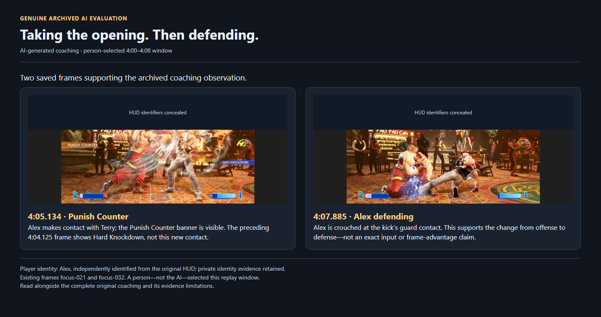
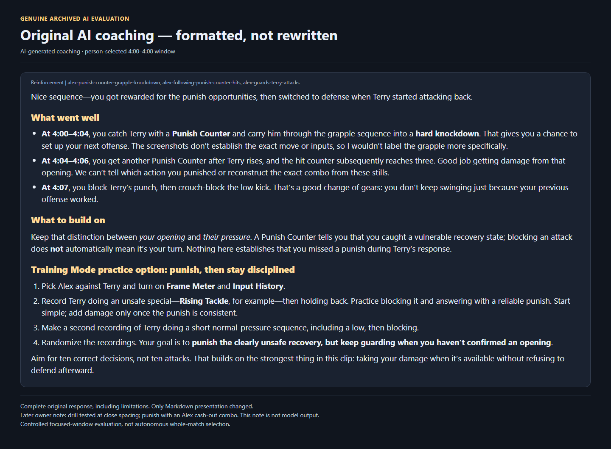

# FG Coach

**One replay. A few meaningful decisions. A better next practice session.**

> **At a glance**
>
> - **Problem:** A replay shows a fighting-game player what happened, but not what to practice next.
> - **Key decision:** I moved the roadmap from detecting more game events to AI coaching that a player can trust and act on, after a technically successful run produced advice that failed human review.
> - **What players said:** In an informal evaluation, 5 of 6 players found the AI-generated coaching helpful. The one advanced player found it a little too generic and unhelpful.
>
> **Status:** local MVP under evaluation. This is a showcase, not a release or public beta, and the development repository is private.

*The FG Coach review screen, rendered locally with human-written example coaching. It is not a screenshot of AI-generated advice. The opponent's online name is concealed.*

FG Coach is a local-first Street Fighter 6 replay-coaching project. It brings replay playback, multimodal AI analysis, evidence-linked coaching, and player feedback into a Windows application.

## What it does

- Plays a replay beside the coaching, with timestamp seeking and distinct markers for gameplay events.
- The planned workflow uses one approval: connect an account, select a replay, approve AI analysis, and review the coaching. Today this runs as a local implementation under evaluation.
- Grounds coaching in machine-generated recognition and focused screenshots, and can reinforce good play or hold back when the evidence is weak.
- Saves reports and per-moment ratings so they reopen without another analysis request.
- Limits each replay to three model requests, with no automatic retries or fallback.

The current design analyzes a replay in two stages. One request surveys 30 images across the whole match and proposes up to two moments to inspect. A second request looks at those moments in detail, and at most one coaching request follows if the evidence supports it.

## Real AI output

This is genuine model output from an archived, controlled evaluation. I picked the 4:00–4:08 window myself, so the model did not choose it from the whole replay. The example reinforces what the player did well and does not invent a mistake.

The practice drill's punish (an Alex cash-out combo) is my own addition and is not part of the model's response. I confirmed the drill works at close spacing, and that check is self-reported and has not been independently reproduced.

Read the [full response, provenance, and limitations](docs/archived-ai-example.md).

## When the AI got it wrong

A later Alex versus Cammy run completed every technical step, but its coaching failed human review. It focused on a closing exchange, missed an earlier decision, and narrated too much. I kept the original result and its failing verdict, and I treated it as a product failure and not a successful release.

That failure led to the current design: gameplay events and coaching decisions are kept separate, each coaching card is rated on its own moment, and the number of requests is capped. The human-written cards in the screenshot show the experience I'm aiming for. They are not evidence that AI delivers it reliably yet.

## What players said

Six fighting-game community members shared their own replays. Five were beginner-to-intermediate players (Bronze to low Diamond) and one was advanced (high Diamond to low Master). I ran each player's replays through the AI coaching model and shared the advice with them.

| Players | Skill level | Feedback |
| --- | --- | --- |
| 5 | Bronze to low Diamond | Helpful for spotting gaps in their play and learning from them |
| 1 | High Diamond to low Master | A little too generic and unhelpful |

They reviewed the coaching output only and did not use the app. This was not a controlled study, and it did not measure accuracy or skill improvement. My hypothesis is that the coaching helps beginner and intermediate players more, and that advanced players need more specific detail. The next round of evaluation is designed to test that.

## What I'd do next

1. Run a supervised test in which the AI picks the useful moments on its own and produces evidence-backed coaching comparable to the human-written examples.
2. Evaluate with more players, including more higher-ranked ones, using replays beyond my development cases.
3. Review factual accuracy independently of whether players found the advice helpful.

## Scope

There is no public installer, application source code, or reproducible live demo here, and automated checks confirm that evidence references are consistent, not that the AI's gameplay claims are correct.

## Read more

- [Product case study](docs/case-study.md)
- [Evaluation approach](docs/evaluation.md)

## My role

I lead the product direction, scope, UX requirements, evaluation, and acceptance decisions, with Codex-assisted implementation and testing. This project is about building and evaluating an AI product, not training a model.

FG Coach is independent and unofficial, and is not affiliated with Capcom or SNK. Street Fighter 6 and other referenced game content belong to their respective owners.
