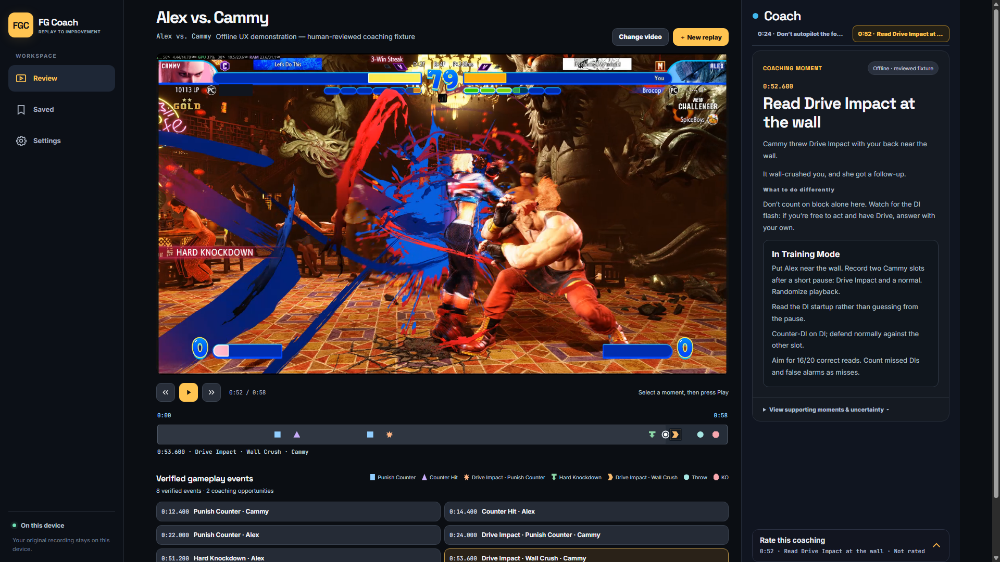

# FG Coach

**Replay review that tells you what to practice, not just what happened.**

FG Coach is a Windows app that reviews a recording of your Street Fighter 6 match, identifies moments to improve, and gives you a short set of coaching notes. Each note is tied to a moment you can jump to in the replay, explains what happened and why it mattered, and where it fits, ends with a practice drill.

**Not a live product.** FG Coach is an unreleased prototype under evaluation, with no public release. This repo is a showcase of how I defined the product, tested AI coaching advice, and changed direction when a run failed human review.

<i>The FG Coach review screen, rendered locally with human-written example coaching. It is not a screenshot of AI-generated advice. The player names shown are my own.</i>

## Who it's for

Fighting games are famously hard to learn, and the games rarely help. Tutorials stop at the basics, the terminology goes unexplained, and new players often assume winning takes long, complex combos.

It doesn't. Most players don't need flashy combos. They need solid fundamentals, and someone to point out what's holding them back.

That's who FG Coach is for: players who want to improve but can't yet tell what to work on, and who have no friend or coach to review their replays with.

## How it works

1. **Pick a replay.** The recording stays on your device.
2. **Approve once.** You approve AI analysis for that replay. Selected screenshots, not the video, are sent to a multimodal AI model.
3. **Get coaching.** The app shows a few coaching notes next to the replay, each with a timestamp, an explanation, an adjustment to try, and a drill when one fits.
4. **Rate and correct.** You rate each note on its own moment. Saved reports reopen without another analysis request.

The planned experience uses one approval for the whole replay. Today this runs as a local implementation.

### Under the hood

The current design analyzes a replay in two stages. One request surveys 30 images across the whole match and proposes up to two moments to inspect. A second request looks at those moments in detail, and at most one coaching request follows if the evidence supports it. Each replay is limited to three model requests, with no automatic retries or fallback. Coaching is grounded in machine-generated recognition and focused screenshots. It can reinforce good play, and it holds back when the evidence is weak.

## My role

I'm the creator and product lead. I defined the player problem and the MVP scope, set the acceptance bar (human review of at least 4 out of 5 on naturalness, understandability, and actionability, plus factual checks), and capped each replay at three model requests. When a run failed human review, I kept the failing verdict and redesigned the product around it.

I work across a set of AI tools with defined roles: Codex for implementation and testing, ChatGPT for engineering planning and review, and Claude for review and documentation. Scope, acceptance, and evaluation decisions are mine.

## Real AI output

This is genuine model output from an archived, controlled evaluation. I picked the 4:00–4:08 window myself, so the model did not choose it from the whole replay. The practice drill's punish (an Alex cash-out combo) is my own addition and is not part of the model's response. I confirmed the drill works at close spacing, and that check is self-reported and has not been independently reproduced.

Read the [full response, provenance, and limitations](docs/archived-ai-example.md).

## When the AI got it wrong

A later Alex versus Cammy run completed every technical step, but its coaching failed human review: it focused on a closing exchange, missed an earlier decision, and narrated too much. I kept the original result and its failing verdict, and treated it as a product failure, not a launch.

That led to the current design: gameplay events and coaching decisions are kept separate, each coaching card is rated on its own moment, and requests are capped. The [case study](docs/case-study.md) covers the reasoning.

## What players said

Six fighting-game community members shared their own replays. I ran each player's replays through the AI coaching model and shared the advice with them.

| Players | Skill level | Feedback |
| --- | --- | --- |
| 5 | Bronze to low Diamond | Helpful for spotting gaps in their play and learning from them |
| 1 | High Diamond to low Master | A little too generic and unhelpful |

They reviewed the coaching output only and did not use the app. This was not a controlled study, and it did not measure accuracy or skill improvement. My hypothesis is that the coaching helps beginner and intermediate players more, and that advanced players need more specific detail. The next round of evaluation is designed to test that.

## What's next

The next milestone is a supervised test with outside players. A public release comes after that, and only if the results hold up.

| Next step | What success looks like |
| --- | --- |
| **1. Establish a coaching-quality baseline** | Fixed regression replays with reference notes written independently of the model. Human reviewers score at least 4 out of 5 on naturalness, understandability, and actionability. Qualified reviewers score factual accuracy separately, with no serious invented moves, inputs, or attributions. |
| **2. Prove autonomous, end-to-end coaching** | In a supervised test, the AI picks the useful moments itself, supports each observation with replay evidence, and delivers coaching comparable to the human-written examples, with no developer intervention between replay and report. |
| **3. Let outside players connect their own account** | A player connects their own AI account, approves analysis of a replay, and gets coaching without anyone handling credentials. Account connection and replay approval stay separate permissions. |
| **4. Validate with real players** | Players across skill levels, including more higher-ranked ones, use the app themselves on replays beyond my development cases, rate how useful it is, and surface problems I missed. |

I'm deliberately leaving out exhaustive move recognition, live coaching during matches, and automatic training-mode setup until the coaching loop works.

## Scope

There is no public installer, application source code, or reproducible live demo here, and automated checks confirm that evidence references are consistent, not that the AI's gameplay claims are correct. The development repository is private, so this repo holds the evidence and write-ups only.

## Read more

- [Product case study](docs/case-study.md): the problem, the decisions that mattered, what failed, and what I learned
- [Evaluation approach](docs/evaluation.md): how I judge whether the coaching is good

FG Coach is independent and unofficial, and is not affiliated with Capcom or SNK. Street Fighter 6 and other referenced game content belong to their respective owners.
