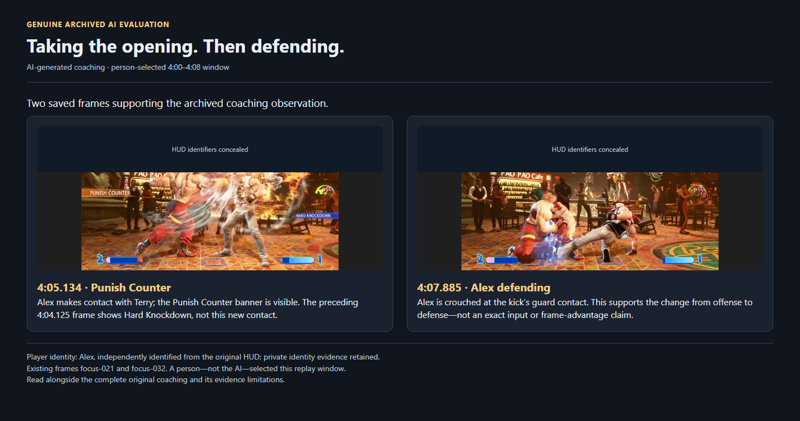
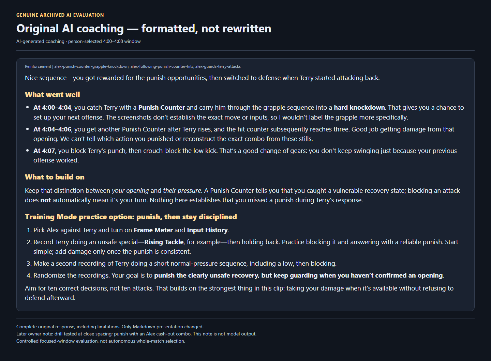

# Alex–Terry — genuine AI coaching

This archived example shows AI recognizing good offense followed by disciplined defense. It is separate from the human-written coaching in the Alex–Cammy application screenshot.

A person selected the 4:00–4:08 window and supplied 32 focused screenshots with previously generated gameplay observations. The AI did not autonomously select the window from the match.

## What the evidence supports

- **4:04.125:** the first sequence reaches three hits and Hard Knockdown.
- **4:05.134:** a separate later contact shows Punish Counter. The lingering Hard Knockdown text belongs to the previous knockdown.
- **4:06.880:** the later sequence's hit counter reaches three.
- **4:07.147 and 4:07.885:** Alex guards Terry's punch, then meets a kick with a crouched guard.

The original HUD identifies Alex as the player. Exact inputs, the grapple's move name, Terry's preceding action, and frame advantage remain unresolved. A low contact pose alone does not establish an attack's hit-height properties.

## Practice verification

The owner confirms the footage is his own, with him playing Alex. He reports that the Rising Tackle exercise works at close spacing across variations, and specifies **Alex cash-out combo** as the punish. This is later human guidance, not wording generated by the AI. No exact combo inputs or damage are certified, and Codex did not independently reproduce the drill.

## The complete original response

The response below is unchanged. Only its Markdown formatting is rendered. Software validation accepted it; the owner's naturalness, understandability, and actionability scores were each 4/5, conditionally at review, before the later practice confirmation. This controlled example is not a representative reliability study or the six-player evaluation summarized in the README.

[Original text file](original-alex-terry-response.txt) · [Technical provenance](example-provenance.json) · [Evaluation approach](evaluation.md) · [Back to FG Coach](../README.md)

Technical provenance records the archived model name, prompt revision, run identity, token usage, and evidence hashes. Those labels identify the historical experiment; they are not required to understand the coaching.

---

Reinforcement | alex-punish-counter-grapple-knockdown, alex-following-punish-counter-hits, alex-guards-terry-attacks

Nice sequence—you got rewarded for the punish opportunities, then switched to defense when Terry started attacking back.

**What went well**
- **At 4:00–4:04**, you catch Terry with a **Punish Counter** and carry him through the grapple sequence into a **hard knockdown**. That gives you a chance to set up your next offense. The screenshots don’t establish the exact move or inputs, so I wouldn’t label the grapple more specifically.
- **At 4:04–4:06**, you get another Punish Counter after Terry rises, and the hit counter subsequently reaches three. Good job getting damage from that opening. We can’t tell which action you punished or reconstruct the exact combo from these stills.
- **At 4:07**, you block Terry’s punch, then crouch-block the low kick. That’s a good change of gears: you don’t keep swinging just because your previous offense worked.

**What to build on**

Keep that distinction between *your opening* and *their pressure*. A Punish Counter tells you that you caught a vulnerable recovery state; blocking an attack does **not** automatically mean it’s your turn. Nothing here establishes that you missed a punish during Terry’s response.

**Training Mode practice option: punish, then stay disciplined**

1. Pick Alex against Terry and turn on **Frame Meter** and **Input History**.
2. Record Terry doing an unsafe special—**Rising Tackle**, for example—then holding back. Practice blocking it and answering with a reliable punish. Start simple; add damage only once the punish is consistent.
3. Make a second recording of Terry doing a short normal-pressure sequence, including a low, then blocking.
4. Randomize the recordings. Your goal is to **punish the clearly unsafe recovery, but keep guarding when you haven’t confirmed an opening**.

Aim for ten correct decisions, not ten attacks. That builds on the strongest thing in this clip: taking your damage when it’s available without refusing to defend afterward.