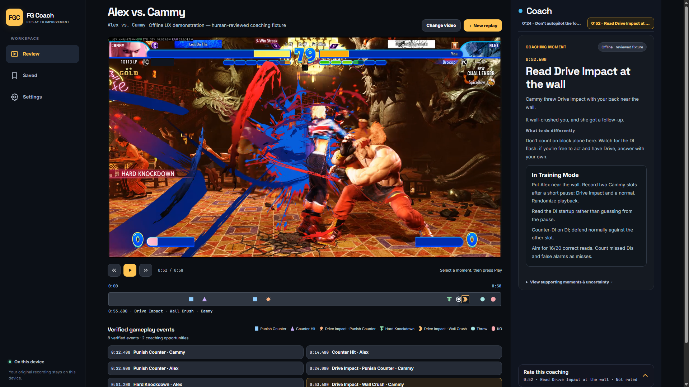
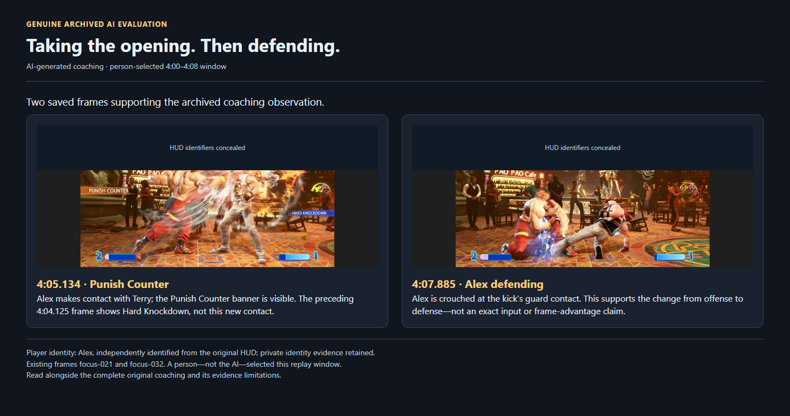

# FG Coach: product case study

**Role:** Creator and product lead (independent project)
**Focus:** AI product strategy, evaluation, and player trust
**Stage:** Local MVP under evaluation; not a public beta

## In brief

FG Coach is a Windows app that reviews a recording of a Street Fighter 6 match and gives the player a few plain-language coaching notes, each tied to a moment in the replay, with one thing to practice next.

The hard part was not getting an AI model to produce fluent advice. It was getting advice a player could trust and act on. That meant testing what the model really produced, keeping a run that failed human review, and changing the product because of it.

## The problem

Fighting-game players improve by reviewing their matches. Replay tools show what happened. They don't tell a player what to practice. Most players have no coach to talk the match through with them, and a list of detected moves is not coaching.

The outcome I wanted: a player finishes a review with a few understandable decisions and one thing to try next.

## What I set out to build

**Connect once, select a replay, approve once, get coaching.** The player watches the replay beside the coaching, jumps to timestamped moments, and rates or corrects each note. The recording stays on the device, while approved screenshots may be sent to an AI model for analysis. Local-first does not mean everything runs locally.

<i>The review screen: the replay beside the coaching, a timeline of verified gameplay events, and a rating control for each note. The coaching shown is human-written.</i>

I defined success before building more. Human reviewers score the coaching for naturalness, understandability, and actionability, and each needs at least 4 out of 5. Factual checks come on top of that. An invented move, event, or player attribution blocks acceptance however fluent the advice sounds.

## What good looks like

The clearest picture of the target is the practice drill in the archived Alex versus Terry example. The model's response got part of the way there: a Training Mode setup and a clear decision rule. I added the punish myself (an Alex cash-out combo), because it shows the ideal end state: a coaching note that doesn't stop at "here's what happened" but ends with something concrete to practice, including what to do once the opening appears.

The goal is for the AI to produce that complete drill itself, grounded in the evidence and checked for accuracy. Right now it doesn't, and I don't count the human-added part as AI output.

<i>The two saved frames behind the archived example: Alex takes the opening, then defends. The model's coaching is based on frames like these.</i>

## The decisions that mattered

**1. Recognition serves coaching, not the reverse.**
My early prototype focused on detecting more game events. It helped, but more detected events did not produce better advice. I moved the roadmap to the player's outcome: a supported decision, why it mattered, a useful adjustment, and a drill when one fits. Reinforcement counts as an outcome too. In the archived Alex versus Terry example, the AI notices the player returned to defense after successful offense and says so, instead of inventing a mistake to correct.

**2. Natural language still needs factual review.**
Plain prompting gave more natural coaching than my earlier structured approach, but it also misidentified moves. I now give the model independently generated recognition findings alongside the screenshots. These checks are guardrails, not proof. A plausible explanation can still misread a move or assume intent.

**3. Technical completion is not product acceptance.**
The first Alex versus Cammy run finished every technical stage, but its coaching failed human review. It narrated a closing exchange, missed an earlier decision, and said too much. I kept the original result and its failing verdict, then redesigned the product around the failure. Gameplay events and coaching decisions are now separate, and each coaching card has its own timestamp, explanation, adjustment, and rating.

**4. Wider coverage without a bigger budget.**
The current design surveys the whole match in one request of 30 images, inspects up to two short windows in detail, and makes at most one coaching request. The ceiling is three requests per replay, with no automatic retries. Three coaching cards is a limit, not a target, and if no window has qualifying evidence, the workflow stops.

**5. Consent a player can understand.**
One informed approval covers the bounded stages of a replay. Saved-run protections prevent duplicate requests after an interruption, and reopening a report never triggers a new analysis. The app warns players about possible credit use and does not claim to enforce included-only funding.

## What the evaluation showed

Six fighting-game community members shared their own replays, and I shared the AI's coaching with each of them.

| Players | Skill level | Feedback |
| --- | --- | --- |
| 5 | Bronze to low Diamond | Helpful for spotting gaps in their play and learning from them |
| 1 | High Diamond to low Master | A little too generic and unhelpful |

They reviewed the advice only and did not use the app. This was an informal study. It did not measure accuracy or improvement, so I treat it as direction, not proof. My hypothesis is that the coaching helps beginner and intermediate players more, and that advanced players need more specific detail.

The accepted coaching cards in the UI are human-written. They show the experience I'm aiming for, not that AI delivers it reliably yet.

## What I owned

- Defined the player problem, MVP scope, and acceptance criteria.
- Directed the shift from detection coverage to coaching usefulness.
- Reviewed real gameplay output for accuracy, naturalness, and whether a player could act on it.
- Chose one replay approval, capped requests, saved records, and honest failure states.
- Guided Codex-assisted implementation and testing, without treating generated code or passing tests as product acceptance.

## How I worked

I run this project like a small team with defined roles. Codex handles implementation and testing. ChatGPT acts as the engineering lead for planning and review. Claude handles review and documentation. I'm the product lead: I set the scope and acceptance criteria, review the real output, and decide what counts as done.

The Alex versus Cammy run shows how that works in practice. Every automated and technical stage passed, and my own review of the coaching is what failed it. The tools produced the work and I decided whether it was good enough.

## What I learned

- **Fluent is not the same as trustworthy.** The question was never whether the model could write polished advice. It was whether a player could check it and use it.
- **A kept failure is worth more than a claimed launch.** Preserving the failed Alex versus Cammy verdict gave me a real reason to redesign, and it keeps this showcase honest.
- **Say what the evidence supports.** Six informal reviews point somewhere. They do not prove anything, and I say so wherever I cite them.

## What's next

1. Run a supervised test in which the AI picks the useful moments itself and produces evidence-backed coaching comparable to the human-written cards.
2. Test with more players, especially higher-ranked ones, on replays beyond my development cases.
3. Review factual accuracy independently of whether players found the advice useful.

[Evaluation approach](evaluation.md) · [Back to overview](../README.md)
